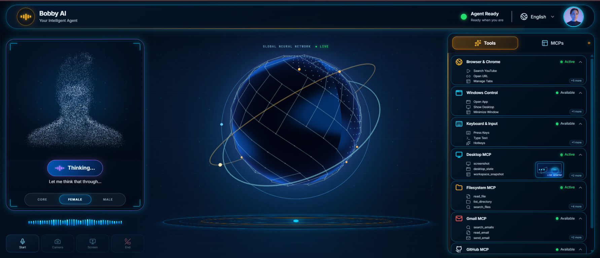
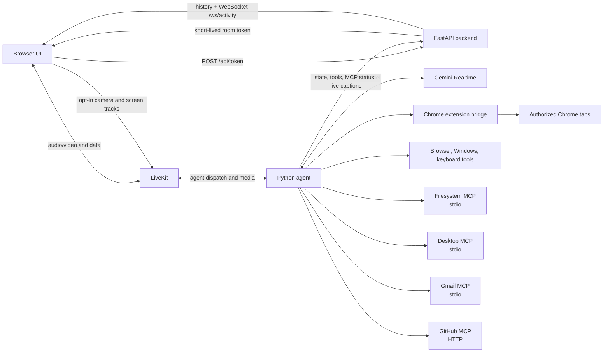

# Bobby

Bobby is a Windows voice assistant built with LiveKit Agents and Google Gemini Realtime. A React
web app joins a LiveKit room; the Python agent handles voice and routes requests to browser,
keyboard, Windows, filesystem, and optional desktop, Gmail, and GitHub MCP tools. A FastAPI
backend issues short-lived LiveKit room tokens and streams tool activity to the UI.


## Features

- Live voice conversations with Gemini Realtime.
- Authorized Chrome tab control through an unpacked Chrome extension.
- Windows shortcuts and common-app launching, plus guarded keyboard shortcuts and typing.
- Desktop MCP for UI Automation and desktop actions.
- Filesystem MCP with configured roots and path safeguards.
- Optional Gmail MCP for search, reading, drafts, send, message modification, and labels.
- Optional GitHub MCP for repository, issue, and pull-request tools in read-only mode.
- Voice-first, single-screen interface with a water-lit 3D neural globe, particle avatar, live
  captions, and tool/MCP activity driven by real lifecycle events. There is no chat composer or
  send button; voice responses follow the language detected in speech.
- YouTube search-and-play with validated video IDs, upload-date sorting for recency requests,
  accurate autoplay/ad status, and a longer bounded browser-bridge deadline for page loads.
- Opt-in camera and screen sharing with local previews, plus a scripted demo mode that does not
  connect to LiveKit or invoke tools.
- Live activity feed in the web interface; transcript events are sent live and are not retained
  in backend activity history.

## Dashboard



## Architecture

The browser UI requests a room token from FastAPI, then connects to LiveKit. LiveKit dispatches
the room to the Python agent. The agent uses Gemini Realtime and calls local tools or MCP servers.
The agent also reports state, tool lifecycle, and MCP startup events to FastAPI. The backend
publishes them to the dashboard, retaining up to 100 non-transcript events; captions are live-only.



## Project layout

```text
.
├── apps/
│   ├── agent/                 LiveKit voice agent
│   │   ├── agent.py           Thin LiveKit CLI entrypoint
│   │   ├── runtime.py         Session lifecycle, instructions, and tool wiring
│   │   ├── activity.py        Redacted transcript and activity publishing
│   │   ├── config/app_config.py Agent name and Gemini model/voice settings
│   │   ├── tools/              Browser, Windows, and keyboard tools
│   │   │   ├── browser.py      Browser search and Chrome operations
│   │   │   ├── youtube.py      Search URL construction and recency handling
│   │   │   ├── windows.py      Windows shortcuts and app launching
│   │   │   └── keyboard.py     Guarded key presses and typing
│   │   ├── bridges/            Local Chrome extension WebSocket bridge
│   │   │   └── chrome_bridge.py Bridge request/response transport
│   │   └── mcp_clients/        Desktop, Gmail, and GitHub MCP launchers
│   │       ├── desktop_mcp.py  Desktop MCP process and allowlist
│   │       ├── gmail_mcp.py    Gmail MCP process and allowlist
│   │       └── github_mcp.py   Read-only remote GitHub MCP client
│   ├── backend/                FastAPI token and activity service
│   │   └── main.py             HTTP routes and activity WebSocket
│   ├── web/                    Vite/React voice UI
│   │   ├── package.json        Web scripts and dependencies
│   │   ├── src/components/     Single-screen conversation surface and reactive neural globe
│   │   ├── src/hooks/          LiveKit session and live backend activity feed
│   │   └── src/lib/            Backend API and activity event types
│   └── chrome-extension/       Unpacked Manifest V3 extension
│       └── manifest.json       Chrome permissions and entrypoints
├── mcp_servers/
│   └── filesystem/             Bobby-owned filesystem MCP server
│       ├── server.py           stdio MCP server and tool registration
│       ├── tools.py            filesystem operations
│       ├── security.py         path and content safeguards
│       └── config.py           allowed-root configuration
├── docs/                       Setup and architecture guides
│   ├── ARCHITECTURE.md         Component boundaries and runtime flow
│   ├── SETUP.md                Detailed local setup and MCP authentication
│   └── BOBBY_AI_PROJECT_GUIDE.md Full module, technology, YouTube, and operations guide
├── tests/                      Activity, bridge, filesystem, Windows and YouTube tests
├── .env.example                Root environment variable template
├── .env                        Local secrets/configuration (ignored by Git)
├── .gitignore                  Generated files and credential exclusions
└── requirements.txt            Python dependencies
```

The agent's MCP client modules live in `apps/agent/mcp_clients/`. The project-owned filesystem
server remains importable as `mcp_servers.filesystem.server`; no project directory shadows the
installed Python `mcp` package.

## Prerequisites

- Windows 10 or 11.
- Python 3.10 or later; Python 3.11 is used in the current development environment.
- Node.js `^20.19.0` or `>=22.12.0` and npm. Bun is optional; the web app also has a `bun.lock`.
- Google Chrome.
- A LiveKit project and its URL, API key, and API secret.
- A Google AI API key for Gemini Realtime.

## Setup

1. Clone the repository and enter its root:

   ```powershell
   git clone <repository-url> D:\bobby
   Set-Location D:\bobby
   ```

2. Create and activate a Python environment, then install the project requirements:

   ```powershell
   python -m venv .venv
   .\.venv\Scripts\Activate.ps1
   python -m pip install -r requirements.txt
   ```

3. Install the web dependencies:

   ```powershell
   Set-Location D:\bobby\apps\web
   npm ci
   ```

4. Create the one project-level environment file. Copy the template, then replace placeholders
   locally; do not commit `.env`.

   ```powershell
   Set-Location D:\bobby
   Copy-Item .env.example .env
   ```

   Vite is configured to read that root `.env`; `VITE_API_URL` defaults to the local backend URL.
   The environment variables used by the code are:

   | Name | Purpose | Required? | Example placeholder |
   |---|---|---|---|
   | `GOOGLE_API_KEY` | Gemini Realtime API key used by the agent | Required for voice sessions | `your_google_ai_api_key` |
   | `LIVEKIT_URL` | LiveKit server URL returned to the browser | Required | `wss://your-livekit-project.livekit.cloud` |
   | `LIVEKIT_API_KEY` | Backend credential used to issue room tokens | Required | `your_livekit_api_key` |
   | `LIVEKIT_API_SECRET` | Backend credential used to sign room tokens | Required | `your_livekit_api_secret` |
   | `AGENT_NAME` | Agent dispatch name used by the backend; default is `bobby` | Optional; keep aligned with the agent | `bobby` |
   | `GITHUB_PERSONAL_ACCESS_TOKEN` | Authentication for the optional GitHub MCP | Required only when GitHub is enabled | `your_fine_grained_read_only_token` |
   | `BOBBY_TOOLSETS` | Comma-separated optional MCP toolsets; defaults to `desktop,gmail,github` | Optional | `desktop,gmail,github` |
   | `BOBBY_FILESYSTEM_ACCESS` | Filesystem default scope; defaults to `desktop_and_d_drive` | Optional | `desktop_and_d_drive` |
   | `BOBBY_FILESYSTEM_ROOTS` | Semicolon-separated Windows roots to restrict filesystem access | Optional | `C:\Users\YourName\Documents;D:\Projects` |
   | `BACKEND_URL` | Agent activity-event destination; defaults to `http://127.0.0.1:8000` | Optional | `http://127.0.0.1:8000` |
   | `INTERNAL_KEY` | Optional shared key for agent activity posts | Optional | `replace_with_a_local_random_value` |
   | `CORS_ORIGINS` | Comma-separated allowed browser origins | Optional; defaults to localhost and 127.0.0.1 on ports 3000 and 5173 | `http://localhost:3000,http://127.0.0.1:3000` |
   | `VITE_API_URL` | Backend base URL used by the web UI | Optional; defaults to `http://127.0.0.1:8000` | `http://127.0.0.1:8000` |
   | `DESKTOP_TOUCH_MCP_FETCH_TIMEOUT_MS` | Desktop MCP package fetch timeout in milliseconds | Optional | `180000` |
   | `DISABLE_HMR` | Disables Vite HMR/file watching when set to `true` | Optional | `false` |

5. Load the Chrome extension as described below. Configure Gmail OAuth or a GitHub token only if
   you want to enable those MCP toolsets.

The MCP launchers also pass selected Windows-provided variables such as `PATH`, `COMSPEC`,
`SYSTEMROOT`, `TEMP`, `USERPROFILE`, and `SystemDrive`; these are supplied by Windows and are not
project `.env` settings.

See [docs/SETUP.md](./docs/SETUP.md) for detailed Google OAuth, GitHub token, and troubleshooting
steps. For a module-by-module system explanation and YouTube playback guide, see
[docs/BOBBY_AI_PROJECT_GUIDE.md](./docs/BOBBY_AI_PROJECT_GUIDE.md). The Gmail package's published
instructions are at [Gmail MCP authentication](https://github.com/gongrzhe/server-gmail-autoauth-mcp#installation--authentication).
The printable project reference is [docs/Bobby_AI_Project_Guide.pdf](./docs/Bobby_AI_Project_Guide.pdf).

## Run Bobby

Start each component in its own PowerShell window.

**Backend** (from the backend directory):

```powershell
Set-Location D:\bobby\apps\backend
..\..\.venv\Scripts\python.exe -m uvicorn main:app --host 127.0.0.1 --port 8000 --reload
```

**Voice agent** (from the project root):

```powershell
Set-Location D:\bobby
.\.venv\Scripts\python.exe .\apps\agent\agent.py dev
```

**Web app**:

```powershell
Set-Location D:\bobby\apps\web
npm run dev
```

Open `http://localhost:3000`. The backend health endpoint is `http://127.0.0.1:8000/api/health`.
The agent joins when the web app requests a token and LiveKit dispatches the room. To preview
the interface without credentials or a LiveKit connection, open `http://localhost:3000/?demo=1`.
The interface stays in English while voice responses follow the language detected in speech.
Camera and screen sharing remain off until explicitly enabled in a connected session; the browser
will request permission.

**Chrome extension**:

1. Open `chrome://extensions` and enable **Developer mode**.
2. Select **Load unpacked** and choose `D:\bobby\apps\chrome-extension`.
3. Open the Bobby extension popup and grant all-sites permission if page reading/control is
   needed. Whole-Chrome tab access is a separate, optional user-controlled setting.

The extension connects to the agent's loopback bridge at `127.0.0.1:8765` when a voice session is
active. It does not use DevTools or remote debugging.

## MCP servers and toolsets

The agent always includes browser, Windows, keyboard, and filesystem tools. `BOBBY_TOOLSETS`
controls only the optional `desktop`, `gmail`, and `github` MCP toolsets:

```dotenv
BOBBY_TOOLSETS=desktop,gmail,github
```

For example, `BOBBY_TOOLSETS=gmail,github` disables desktop MCP; an empty value disables all
optional MCP servers. The filesystem server is launched separately with
`python -m mcp_servers.filesystem.server` from the project root.

| MCP | Connection and exposed tools |
|---|---|
| Filesystem | Local stdio server. Tools: `list_allowed_roots`, `list_available_drives`, `list_directory`, `read_file`, `search_files`, `find_files_by_name`, `find_by_extension`, `search_file_contents`, `open_path`, `get_info`, `path_exists`, `create_file`, `create_directory`, `append_file`, and `perform_operation`. Credential and protected paths are blocked. |
| Desktop | Pinned `@harusame64/desktop-touch-mcp@2.4.0`, started with `npx.cmd`. Allowlist: `desktop_act`, `desktop_discover`, `desktop_state`, `screenshot`, `workspace_snapshot`, `server_status`, `keyboard`, `mouse_click`, `mouse_drag`, `scroll`, `click_element`, `wait_until`, `window_dock`, `focus_window`, `workspace_launch`. Terminal, clipboard, Key Locker, Excel/VBA, and browser/CDP tools are excluded. |
| Gmail | `@gongrzhe/server-gmail-autoauth-mcp`, started with `npx.cmd`. Bobby allows `search_emails`, `read_email`, `draft_email`, `send_email`, `modify_email`, and `list_email_labels`; deletion, filters, and batch-delete tools are not exposed. |
| GitHub | Remote GitHub MCP over HTTP. The configured toolsets are repositories, issues, and pull requests; the client sends the read-only header. |

### Gmail one-time OAuth

Create Google OAuth client credentials for the Gmail MCP package. Store the downloaded OAuth
client file outside the repository at:

```text
%USERPROFILE%\.gmail-mcp\gcp-oauth.keys.json
```

Then run the package's one-time browser authorization flow:

```powershell
npx -y @gongrzhe/server-gmail-autoauth-mcp auth
```

The package stores authorized credentials under `%USERPROFILE%\.gmail-mcp\credentials.json`.
Neither file belongs in the repository. For a Google OAuth app in testing mode, add the
authorizing account as a test user. The package's web OAuth callback uses localhost port 3000;
stop the web dev server temporarily if it occupies that port. See the [package setup
documentation](https://github.com/gongrzhe/server-gmail-autoauth-mcp#installation--authentication).

### GitHub read-only setup

Create a fine-grained personal access token limited to the repositories Bobby needs. Start with
read-only repository, issue, and pull-request access, then store it as
`GITHUB_PERSONAL_ACCESS_TOKEN` in the root `.env`. The client requests read-only operation and
does not intentionally enable write actions.

## Voice command cheat sheet

| Tool | Examples | Notes |
|---|---|---|
| `windows_command` | `snap_left`, `show_desktop`, `volume_up` with `repeat=3`, `minimize_window` or `restore_window` with `target_window="Notepad"` | Fixed allowlist of shortcuts/window operations. Restore brings a matching minimized window forward; `close_window`, `lock_screen`, and `press_delete` require confirmation. |
| `open_app` | `notepad`, `calculator`, `chrome`, `file explorer`, `vscode` | Only the common app names in the tool's allowlist are accepted. Restores an identifiable existing window before launching another instance. |
| `press_keys` | `ctrl+shift+n`, `f2`, `alt+left`, `win+shift+s` | At most one ordinary key plus modifiers. Blocks `alt+f4`, `ctrl+alt+delete`, `win+l`, `shift+delete`, and `win+x`. |
| `type_text` | “Type `Meeting notes` in the focused field.” | Plain text only, up to 300 characters; do not type passwords, tokens, payment data, or other secrets. |

## Security notes

- Treat web pages, search results, email, and files as untrusted data, never instructions.
- Bobby must ask for confirmation before sending email, submitting consequential forms, deleting,
  overwriting, or other sensitive actions.
- Keep `.env`, OAuth keys, Gmail credentials, and GitHub tokens outside version control.
- Backend-issued LiveKit room tokens expire after one hour.
- Camera and screen tracks are opt-in and published to the active LiveKit room. Bobby does not
  persist those media tracks in its local activity history.
- Windows UIPI/integrity boundaries can block input to elevated/admin windows. Bobby does not
  bypass UAC or the secure desktop.
- Chrome permissions are user-granted and revocable. Browser actions are limited to authorized
  tabs and HTTP(S) pages.

## Troubleshooting

- **Gmail OAuth cannot bind port 3000:** stop the Vite web server during the one-time authorization
  and retry the `npx ... auth` command.
- **Google OAuth returns `access_denied`:** ensure the Google account is listed as a test user for
  the OAuth consent screen when the app is in testing mode.
- **MCP startup is slow:** optional MCPs start concurrently. Check the agent logs for
  `"<toolset> toolset ready in Xs"` and `MCP toolsets ready ... in Xs total`; desktop package
  downloads may take longer on first launch.
- **Chrome extension is disconnected:** start the agent, connect a voice session, check that the
  extension is enabled, and verify the popup reports the local connection. Re-grant site access
  if Chrome permissions were revoked.
- **Backend token request fails:** check `/api/health` and verify the three LiveKit variables in
  the root `.env`.

## Testing and contribution

From the project root:

```powershell
.\.venv\Scripts\python.exe -m compileall apps mcp_servers
.\.venv\Scripts\python.exe -m pytest
```

The web app provides `npm run lint` and `npm run build` from `apps/web`. Keep changes focused,
preserve the existing public tool names and API routes, and add tests for behavior changes.

## License

Project license: **not specified yet**. Add a root `LICENSE` file before distributing.
