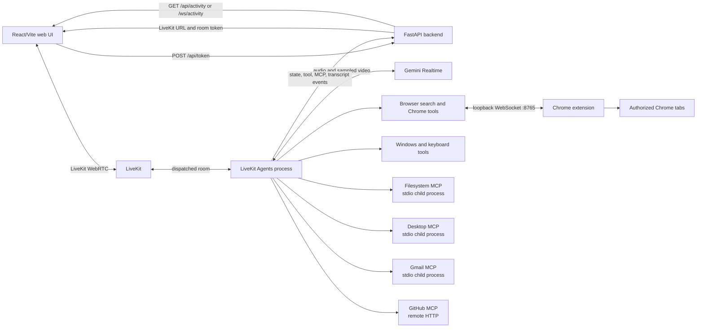

# Bobby architecture

## Runtime components

## Responsibilities

- **Web UI (`apps/web`)** requests a token, joins a LiveKit room, renders the English dashboard,
  holographic assistant, captions, tool timeline, and MCP status cards.
  Camera and screen tracks are opt-in. The UI also consumes the backend activity WebSocket and
  history endpoint. Vite reads the root `.env`; the API helper falls back to
  `http://127.0.0.1:8000`.
- **Backend (`apps/backend/main.py`)** loads the root `.env`, issues a one-hour LiveKit room token
  for agent dispatch, provides `/api/health`, and retains up to 100 non-transcript activity events
  for HTTP and WebSocket clients. Transcript events are delivered to currently connected clients
  but are not stored in history.
- **Agent (`apps/agent/agent.py`)** is the thin LiveKit CLI entrypoint. It adds the project root
  to `sys.path` and starts the server defined in `runtime.py`.
- **Agent runtime (`apps/agent/runtime.py`)** builds a Gemini Realtime session, starts the Chrome
  bridge, registers built-in tools and MCP toolsets, and greets a connected user. It resolves
  `PROJECT_ROOT` from its location and loads the root `.env`, allowing the filesystem child to
  start with `python -m mcp_servers.filesystem.server`.
- **Agent packages** keep configuration in `config/`, tool implementations in `tools/`, the
  browser extension bridge in `bridges/`, and external MCP client launchers in `mcp_clients/`.
- **Chrome extension (`apps/chrome-extension`)** connects to the local bridge and executes only
  supported operations for user-authorized tabs. The agent bridge validates the extension origin
  and only accepts a fixed action allowlist.
- **Filesystem MCP (`mcp_servers/filesystem`)** is a Bobby-owned Python stdio server. It resolves
  operations within configured roots and applies path, credential, and link protections.
- **Desktop and Gmail MCPs** are started as local stdio processes. The desktop client pins its npm
  package and filters discovered tool names; the Gmail client filters its discovered tool list.
- **GitHub MCP** is a remote HTTP server. The client requests repository, issue, and pull-request
  toolsets and passes a read-only header with its authorization token.

## Session flow

1. The web app posts to `POST /api/token`. The backend signs a one-hour token for a uniquely named
   room and dispatches the configured `AGENT_NAME`.
2. The browser joins LiveKit and publishes audio/video only when the user enables them.
3. LiveKit dispatches a job to the agent. The agent requires `GOOGLE_API_KEY`, starts Gemini
   Realtime, and registers browser, Windows, keyboard, and filesystem tools.
4. `BOBBY_TOOLSETS` selects optional desktop, Gmail, and GitHub clients. Their startup tasks run
   concurrently; each optional failure is logged and that unavailable toolset is omitted.
5. Agent tools publish activity to `POST /api/activity`; the backend sends new and recent events
   to `/ws/activity` and `GET /api/activity`. Tool events include a tool group, lifecycle status,
   call ID, and (when available) duration. Transcript text is bounded and credential-like values are
   redacted before publication; it is not retained by the backend.

## Conversation interface

- The full-screen interface remains English-only; spoken-language detection and response do not change the UI.
  The agent speaks Urdu by default and follows English or Pashto when spoken by the user.
- The one-screen interface centers an audio-reactive, water-shaded 3D neural globe and a prominent
  voice control. Camera and screen-share previews, transcript messages, and actual tool/MCP events
  stay inline; typing is secondary. Only the conversation thread scrolls when content exceeds the
  available height.
- Typed messages can connect without requesting microphone access. Voice sessions enable the
  microphone when explicitly started; camera and screen sharing remain opt-in and use the browser's
  permission prompt. Media is published only to the active room and is not recorded by the app.
- Transcript captions are capped and redacted in the agent publisher, streamed only to connected
  clients, and excluded from backend history. Tool activity comes from backend events, not UI mocks.
- Reduced-motion preferences disable CSS motion and globe rotation while preserving audio feedback.
- YouTube playback opens a new tab, chooses a regular video result, and attempts playback. Bobby may
  click only a visible YouTube Skip ad button; playback restrictions and any active ad are reported
  rather than bypassed.

## Activity event shape

The backend accepts activity objects with `type`, optional `tool`, `message`, and optional `data`.
The dashboard recognizes `tool_call`, `tool_result`, `error`, `approval`, `info`, `agent_state`,
`transcript`, `toolset_status`, and `session`. Tool lifecycle metadata uses `group`, `status`,
`call_id`, and optional `duration_ms`; transcript metadata uses `role`, `text`, `language`, and
`is_final`. Do not add raw tool arguments or results: activity events are for status and concise
captions, not a second channel for sensitive tool payloads.

## Paths and process boundaries

`apps/agent/agent.py` computes the project root with
`Path(__file__).resolve().parents[2]` and explicitly loads the root `.env`. The backend independently
uses the same project-root depth from `apps/backend/main.py`. Vite's `envDir` points from
`apps/web` to the root, so no second web `.env` is needed for local configuration.

The filesystem MCP server process inherits only required OS runtime variables and its filesystem
scope settings, not the agent's Google API key. Desktop and Gmail stdio launchers also build
restricted child environments. The GitHub MCP connection is remote and uses the configured token.

## Public interfaces

- HTTP: `/api/health`, `/api/token`, `/api/activity`.
- WebSocket: `/ws/activity`.
- Chrome loopback WebSocket: `/browser` on `127.0.0.1:8765`.
- Filesystem module command: `python -m mcp_servers.filesystem.server`.
- Agent public tool names include `windows_command`, `open_app`, `press_keys`, `type_text`, and
  the `browser_*` tools. Keep these names stable when reorganizing modules.
